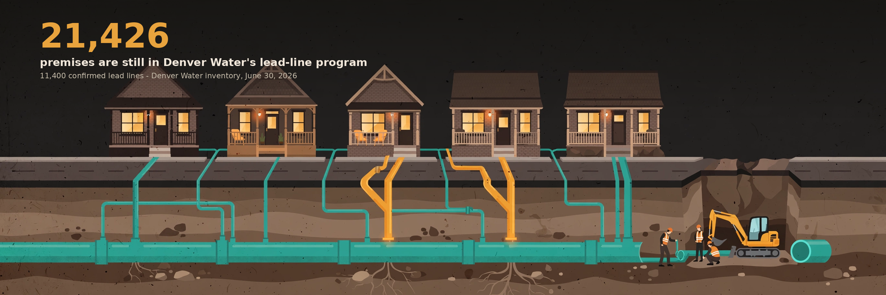

# 21,426 Premises Are Still in Denver Water's Lead-Line Program

A data brief on Denver Water's lead service line inventory: all 311,491 premises in the June 30, 2026 snapshot (pulled October 14, 2026), where the remaining confirmed and likely lead lines sit, and how the recorded replacement pace compares to the federal deadline.

**Headline:** Denver Water's inventory counts 21,426 premises still in its Lead Reduction Program. 18,775 of them are in the City and County of Denver, one in ten city premises. Platte Park alone holds 1,636. The replacements the utility recorded from 2020 to 2023 averaged 5,609 a year, ahead of the 1,863 a year the end-of-2037 federal deadline requires from today's remaining pool - but the public replacements layer ends in May 2024, so the current rate is not checkable from public data.

Read the full brief: [brief-draft.md](brief-draft.md)

## Contents

- `brief-draft.md` - the narrative brief with findings, caveats, and a Who can act section
- `charts/` - hero graphic + 6 data charts (PNG)
- `data/` - the raw ArcGIS downloads, the cleaned premise-level dataset, and `stats.json` with every figure in the brief
- `code/` - download, analysis, chart, income-layer, hero-composition, and verification scripts
- `sources.md` - every figure in the brief with its named source
- `verification.md` - methods checklist, independent verification ledger, layering admission test, reviewer notes
- `social-drafts.md` - LinkedIn post and X thread drafts

## Data sources

All public:

- Denver Water Lead Service Line Inventory, LCRR snapshot dated June 30, 2026 (ArcGIS layer LSLI_20260630), 311,491 premises, pulled October 14, 2026
- Denver Water Lead Service Line Replacements layer (ArcGIS), 24,748 records, dated January 1, 2020 to May 2, 2024
- US EPA, Lead and Copper Rule Improvements FAQ (October 2024), and Colorado Department of Public Health and Environment Lead and Copper Rule page - mandate facts only
- Denver Water program pages (denverwater.org) - program targets and reported totals, attributed in the brief
- US Census Bureau, ACS 2024 5-year estimates, table B19013 (median household income by ZCTA) - ZIP code income layer

## Reproduce

1. Run `python code/download.py` - pulls both ArcGIS layers into `data/`
2. Run `python code/analyze.py` - writes the cleaned dataset and `data/stats.json`
3. Run `python code/layer_income.py` - writes `layer_income_results.json` (ACS layer)
4. Run `python code/charts.py` - charts land in `charts/`
5. Run `python code/verify.py` - independent recomputation of every headline figure; writes `verification_results.json`

Requires Python 3 with matplotlib and pandas.

## Caveats (short version)

The inventory is a snapshot dated June 30, 2026; categories move as investigations resolve unknown lines. The confirmed category includes galvanized-requiring-replacement lines, per Denver Water's own description. The replacements layer ends May 2, 2024, so no current pace is stated. Neighborhood is Denver Water's own field; two scopes (service area, City and County of Denver) are defined in the brief and never mixed. Full methods and caveats in the brief and in `verification.md`.
